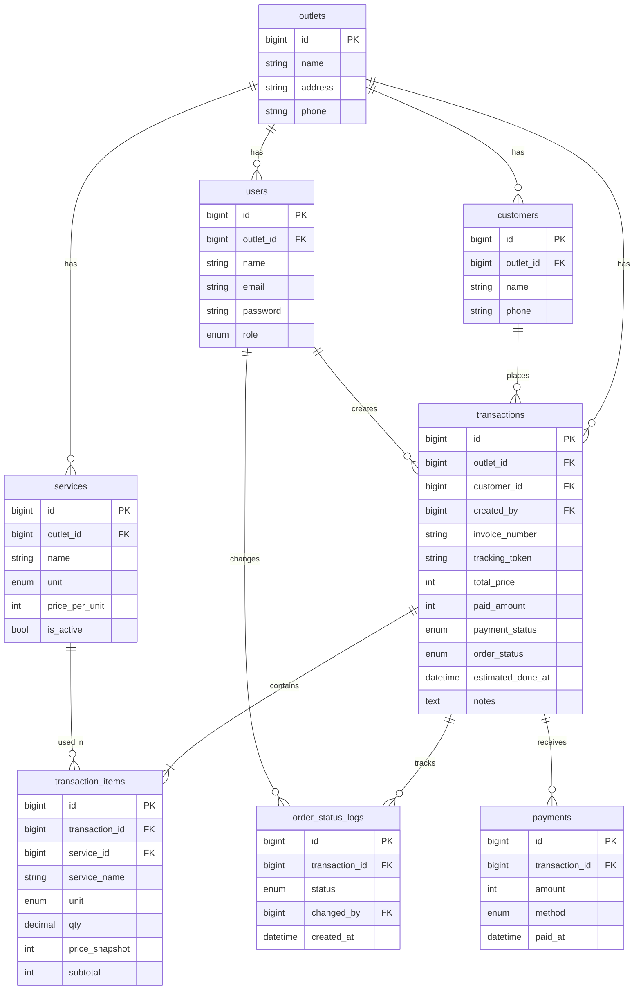

# PRD Final – LaundryYuk POS (MVP)

> Dokumen ini adalah sumber kebenaran (single source of truth) untuk pengembangan dan maintenance.
> Setiap perubahan skema, aturan bisnis, atau scope **wajib** dicatat di bagian [Changelog](#13-changelog).

## 1. Ringkasan

- **Produk:** Aplikasi web POS untuk laundry kiloan/satuan skala UMKM.
- **Pengguna:** Owner dan kasir.
- **Tujuan MVP:** Mencatat transaksi laundry (multi-layanan per nota), melacak status cucian beserta riwayatnya, dan membagikan nota serta link tracking ke pelanggan.
- **Di luar scope MVP:** cetak thermal Bluetooth native, notifikasi WhatsApp otomatis, pembayaran online, multi-cabang per bisnis, laporan lanjutan.

## 2. Arsitektur Teknis

| Komponen | Pilihan |
|---|---|
| Framework | Laravel 11/12 (cek versi terbaru saat mulai) |
| Dashboard | Filament (pakai versi stabil terbaru) |
| Multi-tenancy | Fitur tenancy bawaan Filament (`->tenant(Outlet::class)`) + global scope di model sebagai lapisan kedua |
| Database | MySQL atau PostgreSQL, single database dengan kolom `outlet_id` |
| Uang | Integer rupiah (tanpa desimal) |
| Test | Pest atau PHPUnit |
| UI | Mobile-first (Chrome Android/iOS) |

Catatan istilah: di MVP, **1 outlet = 1 tenant**. Jika nanti butuh multi-cabang, tambahkan tabel `businesses` di atas `outlets`.

## 3. Skema Database

### 3.1 ERD



### 3.2 Detail Tabel

**`outlets`**
`id`, `name`, `address` (nullable), `phone` (nullable), `timestamps`.

**`users`**
`id`, `outlet_id` (FK), `name`, `email` (unique), `password`, `role` (enum: `owner`, `cashier`), `timestamps`.

**`services`**
`id`, `outlet_id` (FK), `name`, `unit` (enum: `kg`, `pcs`), `price_per_unit` (unsigned int), `is_active` (bool, default true), `timestamps`, `softDeletes`.
Gunakan `is_active` atau soft delete agar layanan lama tidak hilang dari transaksi historis.

**`customers`**
`id`, `outlet_id` (FK), `name`, `phone` (nullable), `timestamps`.
Index: unique `(outlet_id, phone)` jika phone terisi.

**`transactions`**
`id`, `outlet_id` (FK), `customer_id` (FK), `created_by` (FK ke users), `invoice_number`, `tracking_token` (string unik, acak, minimal 32 karakter), `total_price` (unsigned int), `paid_amount` (unsigned int, default 0), `payment_status` (enum: `unpaid`, `partial`, `paid`), `order_status` (enum: `received`, `washing`, `ironing`, `ready`, `completed`), `estimated_done_at` (nullable), `notes` (nullable), `timestamps`.
Index: unique `(outlet_id, invoice_number)`, unique `tracking_token`, index `(outlet_id, order_status)`, index `(outlet_id, created_at)`.

**`transaction_items`**
`id`, `transaction_id` (FK, cascade), `service_id` (FK), `service_name` (snapshot nama), `unit` (snapshot), `qty` (decimal 8,2), `price_snapshot` (unsigned int), `subtotal` (unsigned int).
Snapshot nama, unit, dan harga membuat nota lama tetap akurat walau layanan diubah.

**`order_status_logs`**
`id`, `transaction_id` (FK, cascade), `status` (enum sama dengan `order_status`), `changed_by` (FK ke users), `created_at`.
Satu baris dibuat saat transaksi dibuat (`received`) dan setiap kali status naik.

**`payments`**
`id`, `transaction_id` (FK, cascade), `amount` (unsigned int), `method` (enum: `cash`, `transfer`, `qris`), `paid_at`, `timestamps`.
`paid_amount` dan `payment_status` di `transactions` dihitung ulang dari tabel ini setiap ada pembayaran baru.
**Keputusan terbuka:** tabel ini boleh ditunda dari MVP dan cukup memakai `paid_amount` saja.

## 4. Aturan Bisnis

1. **Total harga** = jumlah `subtotal` semua item, dengan `subtotal = round(qty × price_snapshot)`.
2. **Status pesanan** hanya boleh maju satu langkah: `received → washing → ironing → ready → completed`. Mundur hanya boleh oleh owner (opsional, **keputusan terbuka**).
3. **Status bayar** diturunkan dari `paid_amount`: 0 = `unpaid`, kurang dari total = `partial`, sama atau lebih = `paid`.
4. **Nomor invoice** format `INV-YYYYMMDD-NNN`, urut per outlet per hari. Generate di dalam DB transaction dengan lock (atau tabel counter) agar aman dari race condition.
5. **Cucian `completed` dengan pembayaran `unpaid`/`partial`** menampilkan peringatan ke kasir saat diserahkan.
6. **Isolasi data:** semua query otomatis dibatasi `outlet_id` user yang login.

## 5. Fitur MVP

### F1. Autentikasi & Multi-Tenancy
- Register membuat outlet baru dan user owner dalam satu DB transaction.
- Owner bisa menambah akun kasir.
- Semua resource Filament ter-scope ke outlet user.
- Kasir tidak bisa mengelola layanan atau akun (policy berbasis role).

### F2. Manajemen Layanan & Pelanggan
- CRUD layanan (owner), CRUD pelanggan (owner dan kasir).
- Tambah pelanggan cepat langsung dari form transaksi (modal create).

### F3. Transaksi POS
1. Pilih atau buat pelanggan.
2. Tambah satu atau lebih item layanan dengan qty. Total terhitung otomatis.
3. Isi estimasi selesai (default otomatis, misalnya +2 hari) dan catatan.
4. Isi pembayaran awal (opsional, bisa DP).
5. Simpan. Transaksi berstatus `received` dan log status pertama tercatat.

### F4. Tracking Status
- Di list transaksi, tombol aksi satu klik "Naikkan status" dengan konfirmasi singkat.
- Filter list berdasarkan status, status bayar, dan tanggal.
- Halaman detail menampilkan timeline riwayat status.

### F5. Nota & Tracking Publik
- Halaman nota yang rapi dan ramah cetak (`@media print`, lebar 58/80mm), plus tombol **Bagikan ke WhatsApp** (link `wa.me` berisi teks nota dan link tracking).
- Halaman publik `/track/{tracking_token}` tanpa login: menampilkan nama outlet, nomor invoice, status terkini, timeline, dan estimasi selesai. Nama pelanggan disamarkan dan nomor telepon tidak ditampilkan.
- Cetak ke printer thermal Bluetooth **tidak dijanjikan** di MVP. Fase berikutnya: integrasi RawBT atau Web Bluetooth (ESC/POS).

### F6. Dashboard Ringkas (opsional, disarankan)
- Widget Filament: omzet hari ini, jumlah cucian per status, daftar cucian yang lewat estimasi.

## 6. Non-Functional

- Mobile-first, area sentuh minimal sekitar 44px, kolom tabel Filament diringkas di layar kecil.
- Validasi di sisi server untuk semua input (qty > 0, harga >= 0, transisi status valid).
- Rate limit pada route tracking publik.
- Seeder demo: 2 outlet, masing-masing dengan layanan, pelanggan, dan transaksi di berbagai status (untuk demo dan test isolasi).

## 7. Strategi Testing

Minimal yang wajib ada:

- **Tenant isolation:** user outlet A tidak bisa melihat, mengubah, atau menghapus data outlet B (lewat Filament maupun akses langsung ke ID).
- **Kalkulasi:** total harga multi-item, pembulatan, dan snapshot harga tidak berubah setelah harga layanan diubah.
- **Status workflow:** hanya transisi valid yang lolos, dan setiap transisi membuat log.
- **Invoice number:** unik per outlet, tidak bentrok saat dibuat bersamaan.
- **Tracking publik:** token salah menghasilkan 404, dan data sensitif tidak bocor.
- **Otorisasi role:** kasir tidak bisa mengakses menu owner.

## 8. Kriteria Sukses

1. Alur penuh dari HP berjalan: Register → Tambah layanan → Tambah pelanggan → Buat transaksi multi-item → Naikkan status sampai `completed` → Bagikan nota via WhatsApp.
2. Link tracking publik bisa dibuka pelanggan tanpa login dan menampilkan status yang benar.
3. Semua test di bagian 7 lolos (idealnya dengan CI GitHub Actions).
4. Tampilan nyaman dipakai di Chrome HP tanpa scroll horizontal yang mengganggu.
5. Repo punya README dengan: skenario bisnis, ERD, screenshot, cara install, dan akun demo.

## 9. Urutan Pengerjaan

Kerjakan per tahap, satu tahap selesai dan lolos test sebelum lanjut.

1. Setup project, auth, outlet, tenancy, beserta test isolasinya.
2. CRUD layanan dan pelanggan.
3. Transaksi, item, dan kalkulasi total.
4. Status workflow dan log.
5. Pembayaran (DP/partial).
6. Nota dan tracking publik.
7. Dashboard, seeder, README, dan CI.

## 10. Panduan untuk AI Coding Agent (Vibecoding)

Bagian ini dipakai sebagai instruksi tetap setiap kali meminta AI menulis atau mengubah kode.

**Aturan umum**
- Ikuti PRD ini. Jika permintaan bertentangan dengan PRD, tanyakan dulu atau update PRD terlebih dahulu.
- Kerjakan satu tahap (bagian 9) per sesi. Jangan menambah fitur di luar scope.
- Gunakan konvensi Laravel standar: migration, factory, seeder, policy, form request, dan Eloquent relationship.
- Gunakan fitur bawaan Filament sebelum membuat komponen custom.

**Aturan kritis (jangan dilanggar)**
- Semua tabel bertenant wajib punya `outlet_id` dan ter-scope di level model dan Filament.
- Uang selalu integer rupiah. Jangan pakai float atau decimal untuk uang.
- Harga, nama layanan, dan unit di `transaction_items` adalah snapshot. Jangan baca ulang dari `services` saat menampilkan transaksi lama.
- Perubahan `order_status` hanya lewat satu method/service class yang memvalidasi transisi dan menulis `order_status_logs`.
- Pembuatan nomor invoice hanya lewat satu service class dengan lock.
- Halaman tracking publik tidak boleh membocorkan data selain yang tercantum di F5.

**Alur kerja per tugas**
1. Baca bagian PRD yang relevan.
2. Tulis migration dan model, lalu test, lalu implementasi.
3. Jalankan seluruh test sebelum menyatakan selesai.
4. Update changelog dan PRD jika ada perubahan skema atau aturan.

**Template prompt**

```text
Baca PRD-LaundryYuk-POS.md. Kerjakan Tahap [N]: [nama tahap].
Patuhi bagian 10 (aturan kritis). Tulis test sebelum atau bersama implementasi.
Jangan ubah di luar scope tahap ini. Setelah selesai, jalankan semua test
dan ringkas file yang diubah.
```

## 11. Panduan Maintenance

- **Perubahan skema:** selalu lewat migration baru. Jangan edit migration lama yang sudah dijalankan di environment mana pun.
- **Perubahan aturan bisnis:** update bagian 4, tambahkan test, lalu catat di changelog.
- **Dependency:** update Laravel dan Filament secara berkala, baca upgrade guide, jalankan seluruh test sebelum merge.
- **Backup:** database dibackup terjadwal dan pemulihannya pernah diuji.
- **Monitoring:** aktifkan log error (misalnya Sentry atau log harian) sebelum dipakai pengguna nyata.
- **Branching:** satu fitur atau perbaikan per branch, merge lewat pull request dengan CI hijau.
- **Backlog pasca-MVP:** cetak thermal (RawBT/ESC/POS), notifikasi WhatsApp, multi-cabang (`businesses`), laporan lanjutan, membership/poin, ekspor data.

## 12. Keputusan Terbuka

- [ ] Tabel `payments` masuk MVP atau cukup `paid_amount`?
- [ ] Apakah kasir boleh memundurkan status?
- [ ] Versi Filament dan Laravel yang dipakai (cek versi stabil terbaru).
- [ ] Format nama pelanggan yang disamarkan di halaman tracking publik.

## 13. Changelog

| Tanggal | Perubahan |
|---|---|
| 2026-10-04 | Versi final awal: tambah `users`, `transaction_items`, `order_status_logs`, `payments`, tracking publik, strategi testing, panduan AI agent dan maintenance. |
